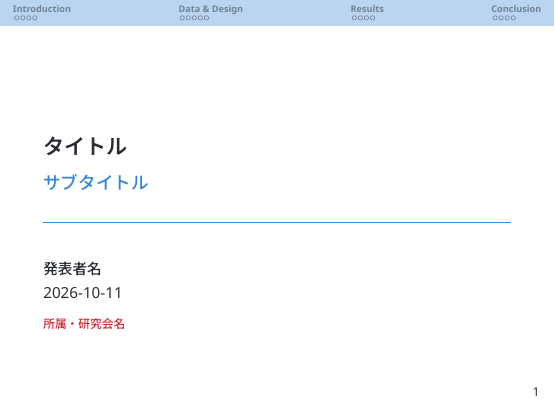
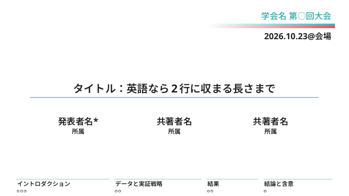
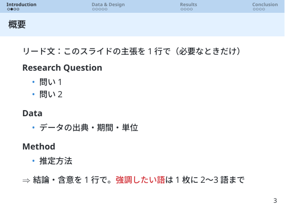
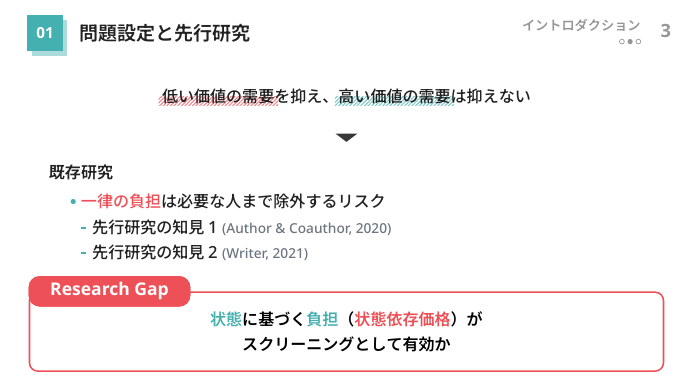

# koyama-beamer：Quarto で作る日本語 Beamer スライド

Markdown（Quarto）で書いて、Beamer の PDF スライドを出すテンプレートです。
経済学などの研究発表向けに、色の役割・表・数式・図のルールを決めてあります。

- デザインの違う **2つの版（v1 / v2）** があります。まず下の「どちらを使うか」で選んでください
- どちらも日本語は Noto Sans JP（欧文は Noto Sans）、文献は biblatex（APA）+ biber、lualatex で PDF にします
- 書き方（Markdown＋一部 LaTeX）、色の名前と役割（`primary`＝構造、`accent`＝強調、`highlight`＝データの注目点）は共通です

**はじめて使う人は [docs/getting-started.md](docs/getting-started.md) を上から順に進めてください**（インストールから最初の PDF まで）。

---

## Claude Code で使う（おすすめ）

VS Code などで Claude Code を使っているなら、このリポジトリをプラグインとして入れると、
研究フォルダで「発表スライドを作りたい」と頼むだけで、版の選択から PDF の確認まで案内されます。
テンプレートもプラグインと一緒に入るので、clone は要りません。

```text
/plugin marketplace add Kenshi-Koyama/koyama-beamer
/plugin install koyama-beamer@koyama-beamer
```

- 使うとき：研究フォルダを開いて「〇〇学会の発表スライドを作りたい」のように頼む。`/koyama-beamer:slides` で呼び出してもよい
- 前提：Quarto・TinyTeX・Noto Sans JP（[getting-started の 2.](docs/getting-started.md)）と、GitHub の招待（Private のため。手順は getting-started の 3.）
- 更新：`/plugin marketplace update koyama-beamer`。`/plugin` の **Marketplaces** で **Enable auto-update** にすると自動で届く

---

## どちらを使うか

| | [v1](ver1/)（4:3） | [v2](ver2/)（16:9） |
|---|---|---|
| 表紙 |  |  |
| 本文 |  |  |
| 縦横比 | 4:3 | 16:9 |
| 今どこにいるか | 上部のナビバー（全セクションと、各スライドの ○） | 右上のセクション名と ○●（セクションの中の位置） |
| スライドのタイトル | 淡い青の帯 | 白地に、セクション番号の四角＋黒字 |
| 色 | 青・赤・橙 | ティール・コーラル赤・橙 |
| 表紙 | タイトル・発表者・所属・日付 | 学会名、著者の名前と所属を横に並べる、最下部に全体の構成と枚数 |
| 目次 | 各セクションの冒頭 | 2つ目以降のセクションの冒頭 |
| 囲み | 定義ボックス・要点の枠など | 加えて、ラベル付きの枠（Research Question / Research Gap）・語句の下の斜線・▼ |
| 見本（PDF） | [ver1/template_ver1.pdf](ver1/template_ver1.pdf) | [ver2/template_ver2.pdf](ver2/template_ver2.pdf) |
| デザインのルール | [ver1/docs/SlideRules.md](ver1/docs/SlideRules.md) | [ver2/docs/SlideRules.md](ver2/docs/SlideRules.md) |
| 応用 | [ver1/docs/recipes.md](ver1/docs/recipes.md) | [ver2/docs/recipes.md](ver2/docs/recipes.md) |

### 選び方の目安

- **会場のスクリーンが 16:9**（最近の学会・オンライン発表）、図や主張を大きく見せたい → **v2**
- **会場が 4:3**、またはゼミなどで、常にナビバーで全体の位置を見せたい → **v1**
- 表紙に**共著者と所属を並べたい**、学会名・会場を入れたい → **v2**（v1 は [ver1/docs/recipes.md](ver1/docs/recipes.md) の 4. で手書き）
- 迷ったら **v2**（新しく作るスライドの標準）。v1 で作った過去のスライドの続きなら v1

---

## 使い方の早見（2回目以降）

環境（Git・Quarto・TinyTeX・Noto Sans JP）と、このリポジトリの clone が済んでいる前提です。
パスの最後の `/ver1`・`/ver2` で版を選びます。

```bash
# 新しいスライドを作る（研究のフォルダの中で）
mkdir -p report/slide && cd report/slide
quarto use template <koyama-beamer のパス>/ver2 --no-prompt   # v1 なら /ver1
quarto render slide.qmd

# テンプレートの更新を受け取る
cd <koyama-beamer のパス> && git pull
```

- できるもの：`slide.qmd`（本体。ここを書き換える）、`ref.bib`（文献）、
  `_extensions/koyama2/`（v1 は `_extensions/koyama/`。テンプレート本体。書き換えない）
- 既にある `.qmd` にテンプレートだけ入れるときは、その `.qmd` のフォルダで `quarto add <koyama-beamer のパス>/ver2` を打ち、
  YAML を `format: koyama2-beamer: default`（v1 は `/ver1` と `koyama-beamer`）にする
- 公開（Public）後は、clone せずに `quarto use template Kenshi-Koyama/koyama-beamer/ver2` でも使える

### YAML のオプション（両方の版で共通）

```yaml
section-outline: false        # セクション冒頭の目次（Outline）を入れない（短い発表用）
bib-file: ../paper/refs.bib   # 文献ファイル（既定はスライドと同じフォルダの ref.bib）
palette:                      # この研究用に色を差し替える（書いた色だけ。各版の recipes.md の 7.）
  primary: "1F4E79"
```

v2 だけのもの（表紙）：`event:`（学会名）、`venue:`（会場）、`shorttitle:`（目次の左上）、
`author:` の `affiliation:`・`presenter: true`（[ver2/docs/recipes.md](ver2/docs/recipes.md) の 4.・10.）。

縦横比・エンジンなど（`aspectratio`、`pdf-engine: lualatex`、`slide-level: 2`、`keep-tex: true`、
`citeproc: false`）はテンプレートが設定するので、YAML に書かなくてよい。

---

## フォルダの構成

```text
koyama-beamer/
├── README.md              ← このページ（どちらを使うか）
├── CHANGELOG.md           ← 変更履歴（v1・v2 共通。更新を取り込む前に読む）
├── .claude-plugin/        ← Claude Code のプラグインとマーケットプレイスの定義
├── skills/slides/         ← Claude Code のスキル（/koyama-beamer:slides）。手順だけを書き、ルールは各版の docs を読む
├── docs/                  ← 両方の版で共通の文書
│   ├── getting-started.md ←   はじめて使う人へ：インストールから最初のスライドまで、困ったとき
│   ├── workflow.md        ←   作る順番（6段階）、カラーパレットの決め方、文言・図表の作り方
│   └── images/            ←   このページの見本の画像
├── ver1/                  ← 4:3 の版（quarto use template <パス>/ver1）
│   ├── template.qmd       ←   見本（新しいスライドの元になる）
│   ├── template_ver1.pdf  ←   見本の PDF
│   ├── ref.bib            ←   文献の見本
│   ├── _extensions/koyama/←   テンプレート本体（format: koyama-beamer）
│   └── docs/              ←   SlideRules.md（デザインのルール）・recipes.md（応用）
└── ver2/                  ← 16:9 の版（quarto use template <パス>/ver2）
    ├── template.qmd / template_ver2.pdf / ref.bib
    ├── _extensions/koyama2/   テンプレート本体（format: koyama2-beamer）
    └── docs/              ←   SlideRules.md・recipes.md
```

`quarto use template` で配られるのは、選んだ版のフォルダの `template.qmd`・`ref.bib`・`_extensions/` だけです。
`template.qmd` は配るときに、使う人のフォルダの名前（例：`slide.qmd`）に自動で変わります。
そのため `.qmd` の名前は版ごとに変えず、`template.qmd` のままにしています
（`docs/` や見本の PDF は配られません）。

---

## テンプレートの版と過去のスライド

`quarto use template` / `quarto add` は、テンプレートを**各スライドのフォルダに複製**します。
このリポジトリが更新されても、過去のスライドは作ったときの版のまま変わりません（発表済みの見た目が崩れない）。
作りかけのスライドに新しい版を入れる方法は [getting-started.md の 6.](docs/getting-started.md) を見てください。
版によって命令や色の名前が変わることがあるので、取り込む前に [CHANGELOG.md](CHANGELOG.md) を確認してください。

---

## 管理者向け：テンプレートを直すとき

1. 直す版のフォルダで、`_extensions/`（v1 は `koyama/`、v2 は `koyama2/`）を直す。ルールが変わるなら、その版の `docs/` も
2. その版のフォルダで `quarto render template.qmd -o template_ver2.pdf`（ver1 は `-o template_ver1.pdf`）を打ち、
   見本が崩れていないことを確認する（`-o` を付けないと `template.pdf` ができる。これは Git の管理外）。
   見た目が変わったら、README の画像も作り直す（`pdftoppm -png -r 110 -f 3 -l 3 -singlefile ver2/template_ver2.pdf docs/images/v2-slide`）
3. その版の `_extensions/…/_extension.yml` の `version` を上げ、`CHANGELOG.md` に書く
4. フォルダや文書の場所・手順が変わったら、スキル（`skills/slides/SKILL.md`）も直し、`claude plugin validate .` で確かめる
5. コミットしてタグ（例：`v1.2.0`、`v2.0.1`）を付け、`git push origin main --tags`。
   プラグインは `version` を書いていないので、push したコミットがそのまま更新として届く
6. 使っている人に、更新したことと CHANGELOG の要点を連絡する
